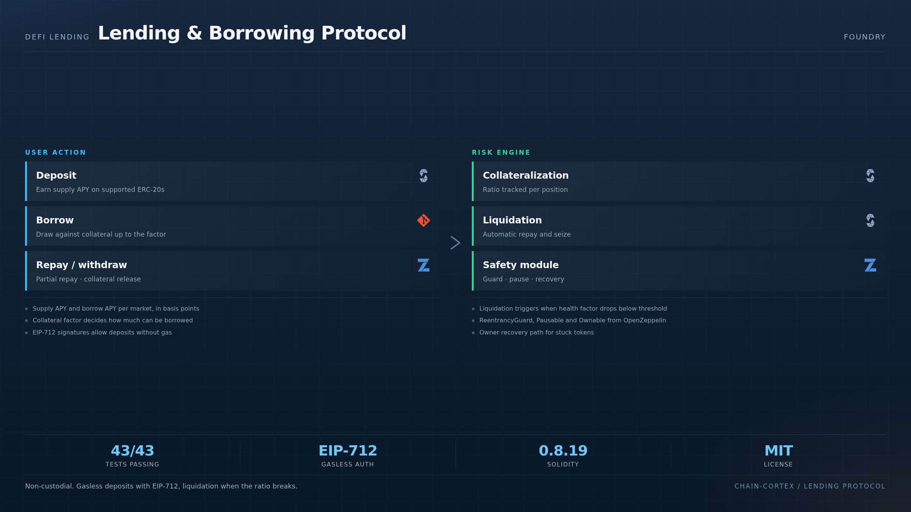

# DeFi Lending & Borrowing Protocol

> A complete decentralized lending protocol with collateral management, off-chain signatures, and liquidation mechanisms — built from scratch with Foundry.

[](https://soliditylang.org)
[](https://book.getfoundry.sh)
[](#tests)
[](https://openzeppelin.com)
[](LICENSE)

---

<p align="center">
  
</p>

### How the protocol works

A non-custodial lending market where every asset pair has its own supply APY, borrow APY and collateral factor. Users deposit to earn, borrow against their collateral up to that factor, repay partially or fully, and withdraw while their position stays safe. Deposits can be authorised **gasless** with EIP-712 signatures and per-user nonces. When the collateralisation ratio drops below the threshold the position is liquidated. `ReentrancyGuard`, `Pausable` and `Ownable` come from OpenZeppelin, and an owner-controlled recovery path rescues tokens stuck in the contract.


---

## 🎯 What it does

A non-custodial lending protocol where users can:

- **Deposit** supported ERC-20 tokens to earn interest (supply APY)
- **Borrow** against their deposited collateral at a configurable borrow APY
- **Repay** loans partially or fully
- **Withdraw** collateral (if position remains safe)
- **Get liquidated** when their collateralization ratio drops below threshold
- **Use off-chain signatures** (EIP-712 / ECDSA) for gasless deposit authorizations
- **Recover tokens** in emergencies via owner-controlled function

Built with `ReentrancyGuard`, `Pausable`, and `Ownable` from OpenZeppelin.

---

## 🏗 Architecture

```
┌────────────────────────────────────────────┐
│              LendingProtocol               │
├────────────────────────────────────────────┤
│  Markets: mapping(token => Market)         │
│    ├─ totalSupply / totalBorrow            │
│    ├─ supplyRate / borrowRate              │
│    └─ collateralFactor (basis points)      │
│                                            │
│  Users: mapping(address => User)           │
│    ├─ totalDeposited / totalBorrowed       │
│    └─ lastUpdateTime                       │
│                                            │
│  Per-user-per-token deposits/borrows       │
│  Per-user signature nonces                 │
└────────────────────────────────────────────┘
            │
            ├─ uses SafeERC20 for transfers
            ├─ uses ReentrancyGuard on state-changing fns
            ├─ uses ECDSA + MessageHashUtils for off-chain sigs
            └─ uses Pausable for emergency stops
```

---

## 📂 Project structure

```
src/
└── LendingProtocol.sol         # 562 LOC — main protocol
test/
└── LendingProtocol.t.sol       # 830 LOC — 43 tests
```

---

## 🔑 Key functions

| Function | Purpose |
|---|---|
| `addMarket(token, collateralFactor)` | Owner adds a new supported token market |
| `updateMarket(token, collateralFactor, ...)` | Owner adjusts market parameters |
| `deposit(token, amount)` | User deposits collateral |
| `withdraw(token, amount)` | User withdraws collateral (reverts if unsafe) |
| `borrow(token, amount)` | User borrows against collateral (reverts if unsafe) |
| `repay(token, amount)` | User repays outstanding loan |
| `depositWithSignature(...)` | Gasless deposit via EIP-712 signature |
| `liquidate(user, token, amount)` | Anyone can liquidate an unsafe position |
| `getCollateralizationRatio(user)` | View: returns collateral / debt ratio (bps) |
| `canWithdraw / canBorrow / isLiquidatable` | View predicates for safety checks |
| `pause() / unpause()` | Owner emergency controls |
| `emergencyRecover(token, to, amount)` | Owner token recovery (post-pause) |

---

## 🛡 Security considerations

- **Reentrancy:** all state-changing functions are `nonReentrant`
- **Pause switch:** owner can pause all user-facing operations in an emergency
- **SafeERC20:** all token transfers go through the safe wrapper (handles non-standard returns)
- **Off-chain signatures:** ECDSA recovery validated against `address(0)`; nonces prevent replay; deadlines prevent stale sigs
- **Collateralization:** every withdraw/borrow re-validates the position; reverts on unsafe state
- **Owner is trusted:** `addMarket`, `updateMarket`, `emergencyRecover` are owner-only

> ⚠️ This is a **Master's project**, not production. It is a learning artifact. The patterns are correct, but for a real deployment you would add: oracle-based pricing (currently mocked), a continuous interest-rate model, and a more robust liquidation mechanism (Dutch auctions, etc.).

---

## 🧪 Tests (43 passing)

```bash
bash install.sh
forge build
forge test -vv
```

Categories covered:

- **Market management:** add, update, invalid factor, inactive market
- **User flows:** deposit, withdraw, borrow, repay
- **Reverts:** zero amount, insufficient deposit/borrow, unsafe position
- **Signatures:** expired deadline, invalid nonce, invalid signature, replay
- **Liquidation:** revert on insufficient borrow, revert on not-liquidatable, success path
- **Pause / unpause / emergency recover**
- **Edge cases:** zero-address, zero-amount, market state consistency

---

## 📚 Concepts demonstrated

- Collateralized lending with health-factor checks
- Off-chain signatures (EIP-712 / ECDSA) for gasless operations
- Reentrancy protection with the checks-effects-interactions pattern
- Multi-token market management
- Owner-controlled emergency pause
- Comprehensive Foundry test suite (43 tests, edge cases)

---

## 📜 License

MIT — see [LICENSE](LICENSE)

---

**Author:** Santiago López Castaño · [@santilpz28](https://github.com/santilpz28)
Built as part of the **Master in Blockchain Development** (2026) — DeFi module, final project.
